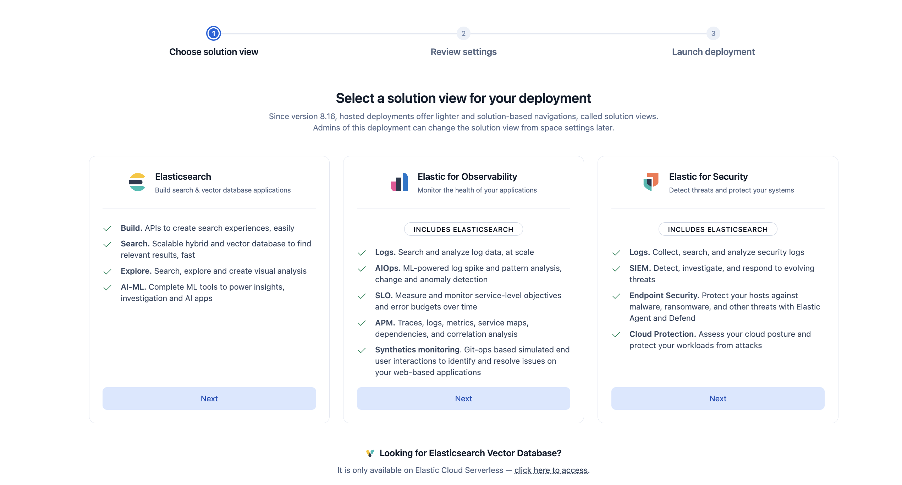
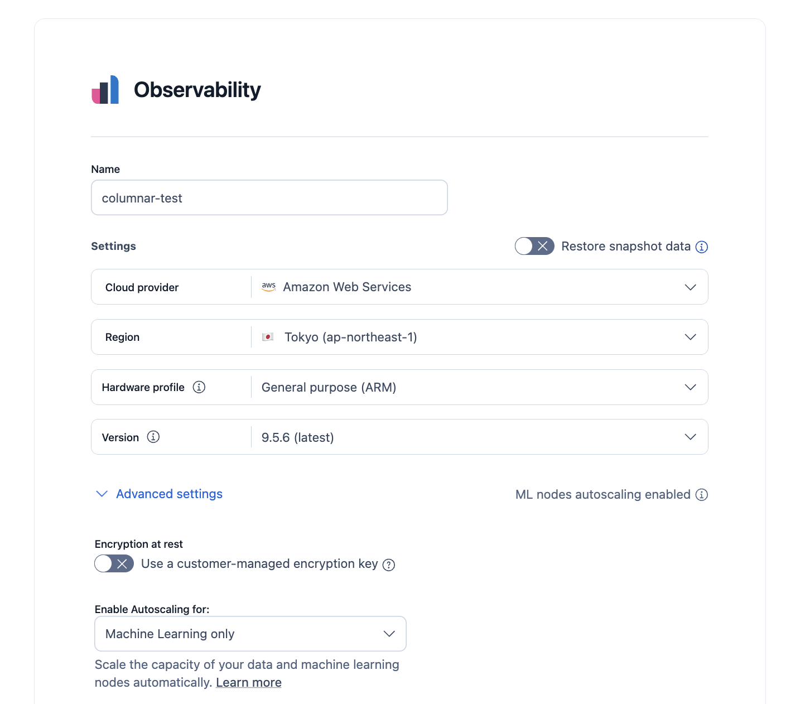
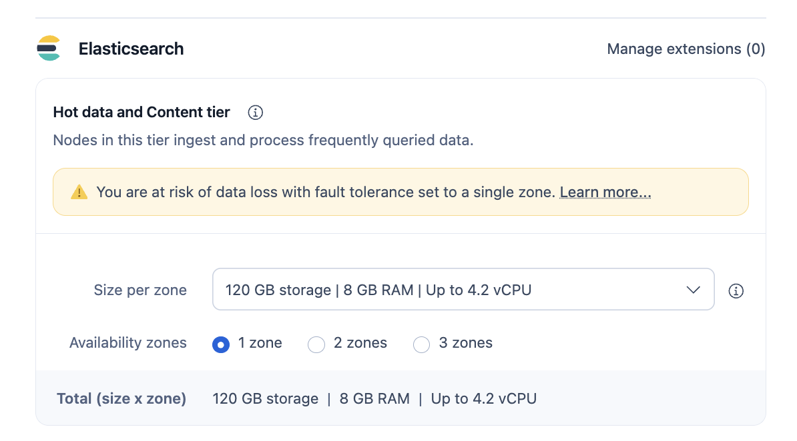
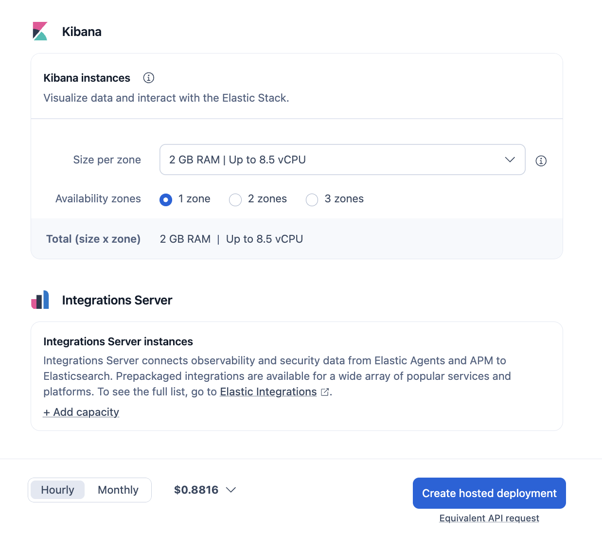
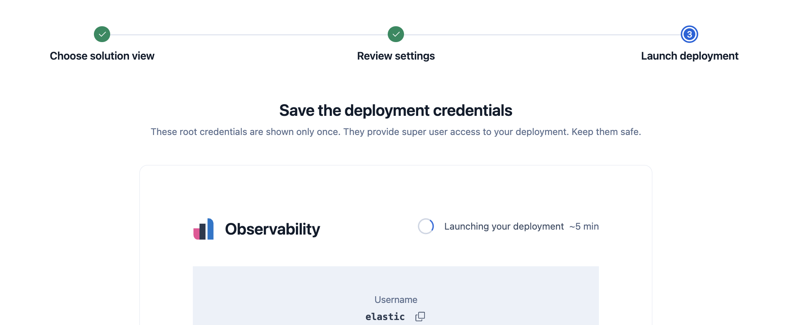
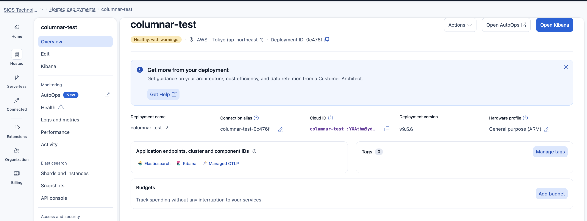
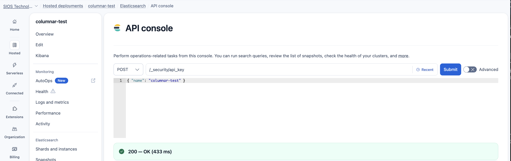

# Elasticsearch の Columnar モードを 100 万件のログで検証する（logsdb との違いと、完全再現手順つき）

Elasticsearch 9.5 で、新しいインデックスモード「Columnar（カラムナー）モード」が Tech Preview として登場しました。
「ディスク使用量を大きく減らせる」と聞くと魅力的ですが、何がどう変わるのかは、ドキュメントを読むだけではつかみにくいものです。

この記事では、次の 3 つをまとめています。

1. Columnar モードがどんな考え方で作られたのかを、1 つ前の世代である logsdb モードと比べながら説明します。
2. Web アクセスログ 100 万件を Elastic Cloud に投入し、通常モード、logsdb モード、Columnar モードの 3 つでディスク使用量と検索速度を比べた結果を紹介します。
3. 同じ検証を誰でも再現できるように、環境構築からスクリプトの実行、後片付けまでの手順をすべて書いています。スクリプトと結果はこのリポジトリに入っています。

日本語の情報がまだ少ない機能なので、長くなっても省略せずに書きました。
最初に結論と背景を読み、再現手順は必要になったときに戻ってくる、という読み方をおすすめします。

対象バージョンは Elasticsearch 9.5.6、環境は Elastic Cloud Hosted です。検証日は 2026 年 11 月 9 日です。

## 目次

1. [結論を先に](#1-結論を先に)
2. [背景：Elasticsearch はデータを 4 つの形で持っている](#2-背景elasticsearch-はデータを-4-つの形で持っている)
3. [1 つ前の世代：logsdb モード](#3-1-つ前の世代logsdb-モード)
4. [新しい世代：Columnar モード](#4-新しい世代columnar-モード)
5. [検証の設計](#5-検証の設計)
6. [再現手順](#6-再現手順)
7. [結果](#7-結果)
8. [考察と使い分け](#8-考察と使い分け)
9. [ハマりどころ](#9-ハマりどころ)
10. [使う前に知っておくこと](#10-使う前に知っておくこと)
11. [まとめ](#11-まとめ)
12. [参考資料](#12-参考資料)
13. [付録：リポジトリの構成](#13-付録リポジトリの構成)

## 1. 結論を先に

| 観点 | 結果 |
|---|---|
| ディスク使用量 | 通常モード 135 MB、logsdb 56.8 MB、Columnar 51.1 MB。Columnar は通常モード比 62% 減、logsdb 比 10% 減 |
| 書き込み速度 | 今回の投入条件では大きな差なし（サーバー側の処理時間 35〜38 秒） |
| 集計クエリ | 同等（約 100 ms）。1 回目は Columnar が最短（参考値） |
| 絞り込みクエリ | Columnar が遅い。0〜3 ms が 15〜51 ms に。索引のない keyword ではスコアも付かない |
| _source の形 | Columnar は平らなドット区切りで返る |

一言でいうと、Columnar モードは「ディスクを 6 割減らす代わりに、1 件を探す検索が数十 ms 遅くなり、_source の形が変わる」モードです。
集計と時系列の絞り込みが中心のログには向いています。索引のない keyword の値で 1 件を素早く探す用途や、関連度順に並べる用途には向きません。`_id` での取得は索引が残るので遅くなりません。

## 2. 背景：Elasticsearch はデータを 4 つの形で持っている

Columnar モードを理解するには、Elasticsearch が 1 件のドキュメントを内部でどう保存しているかを知る必要があります。
実は、1 つのフィールドの値が、用途ごとに別々の形で複数回保存されています。

| 保存形式 | 役割 | たとえると |
|---|---|---|
| _source | 投入した JSON をそのまま保存する。検索結果として返すときに使う | 原本のコピー |
| 転置インデックス（inverted index） | 「この単語はどのドキュメントにあるか」を引く。キーワードや全文の検索に使う | 本の巻末の索引 |
| BKD 木（points） | 数値、IP、日付の範囲検索に使う | 数直線 |
| doc values | 1 つのフィールドの値を、ドキュメント順に列として並べて保存する。集計やソートに使う | 表計算ソフトの 1 列 |

つまり、通常モードでは「status_code = 200」という 1 つの値が、_source、BKD 木、doc values の 3 か所に保存されています。
検索を速くするためにはこれが必要ですが、その分ディスクを使います。

ここで大事なのは、最後の doc values です。
doc values は「列ごとに値を並べた形」で、これはまさにカラムナー（列指向）の保存形式です。
Elasticsearch は 1.0 のころからこの仕組みを持っていました。Columnar モードは、ゼロから新しい仕組みを作ったのではなく、この doc values を主役に据え直したものです。

## 3. 1 つ前の世代：logsdb モード

Columnar モードの前に、logsdb モードという「ログ向けの省スペースモード」がありました。
Elastic Stack 9.0 で GA（正式版）になり、`logs-*-*` という名前の新しいデータストリームでは標準で有効になっています。

logsdb モードがやったことは、大きく 2 つです。

1 つ目は、_source（原本のコピー）を保存しないことです。
代わりに、検索結果を返すときに doc values などから元の JSON を組み立て直します。これを synthetic _source（合成ソース）と呼びます。
原本を持たないので、その分ディスクが減ります。

2 つ目は、インデックスソートです。
同じホストのログを並べて置くと、似た値が連続するので圧縮が効きやすくなります。logsdb は `host.name` と `@timestamp` で並べ替えて保存します。

公式ドキュメントによると、この 2 つでディスク使用量を最大 60% 減らし、書き込み性能への影響は 10〜20% 程度とされています。

ただし、logsdb モードにも残っているものがあります。
転置インデックスと BKD 木です。つまり logsdb は「原本は捨てたが、従来の索引の多くは持っている」状態です。
「多く」と書いたのは、ソート列の一部では索引の代わりに doc value skipper を使うからです。あとで出す内訳の表でも、logsdb の @timestamp の BKD 木は 0 になっています。
この「索引」の部分に手を入れたのが、次の Columnar モードです。

## 4. 新しい世代：Columnar モード

一言でいうと、Columnar モードは「すべてのフィールドを doc values として 1 回だけ保存する」モードです。

通常モードと比べると、こう変わります。

| | 通常モード | logsdb モード | Columnar モード |
|---|---|---|---|
| _source（原本） | 保存する | 保存しない（合成） | 保存しない（合成、平らな形） |
| 転置インデックス（keyword など） | 作る | 作る | 作らない |
| BKD 木（数値、IP、日付） | 作る | 作る | 作らない |
| 転置インデックス（text） | 作る | 作る | 作る |
| doc values | 作る | 作る | 作る（主役） |
| インデックスソート | なし | host.name と @timestamp | host.name と @timestamp（logsdb_columnar の場合） |

ここで混乱しやすいのは、「索引がないなら検索できないのでは」という点です。
答えは「検索できる」です。ただし方法が変わります。

転置インデックスがないフィールドを検索するとき、Columnar モードは doc values（列）を上から読んで条件に合うものを探します。
これだけだと 100 万件すべてを読むことになりますが、doc value skipper という仕組みがそれを助けます。
skipper は、列をブロックに分けて、各ブロックの最小値と最大値を記録したものです。
「status_code >= 500」を探すとき、最大値が 404 のブロックは読まずに飛ばせます。
インデックスソートでデータが並んでいるほど、この読み飛ばしがよく効きます。

text 型のフィールドだけは例外で、転置インデックスが残ります。全文検索には索引が必要だからです。

Columnar モードには 2 種類あります。

- `columnar`：汎用。ソートの設定は自分で決める。
- `logsdb_columnar`：ログ向け。logsdb と同じ既定値（@timestamp のマッピング、host.name と @timestamp のソート）が入る。

ログを扱うなら `logsdb_columnar` を使います。この記事の検証もこちらです。

## 5. 検証の設計

### 比べるもの

同じデータを、同じマッピング、同じシャード数で、3 つのインデックスに入れて比べます。

| インデックス名 | モード | 役割 |
|---|---|---|
| access-logs-standard | 通常（mode を指定しない） | 比較の基準 |
| access-logs-logsdb | logsdb | 1 つ前の世代 |
| access-logs-columnar | logsdb_columnar | 検証対象 |

条件をそろえないと、モードの差なのか設定の差なのか分からなくなります。
特にシャード数は 1、レプリカは 0 に固定し、forcemerge で 1 セグメントにそろえてから計測します。

### 検証環境

| 項目 | 値 |
|---|---|
| 環境 | Elastic Cloud Hosted、AWS ap-northeast-1（東京） |
| バージョン | Elasticsearch 9.5.6 |
| ライセンス | Enterprise（Elastic Cloud 標準） |
| Hot tier | 8 GB RAM、1 ゾーン。Warm/Cold/Frozen、ML、Integrations Server は無し |
| クライアント | macOS、Python 3.14（3.9 以上なら動きます）、curl。インターネット経由 |

### データ

Python で生成した合成データです。外部ライブラリは使っていません。1 件はこのような形です。

```json
{
  "@timestamp": "2026-11-06T14:30:15.123Z",
  "http": {
    "request": { "method": "GET" },
    "response": { "status_code": 200, "bytes": 4520 }
  },
  "client": { "ip": "192.168.1.45" },
  "url": { "path": "/api/v1/products/item-9823" },
  "duration_ms": 42.5,
  "service": { "name": "order-service", "environment": "production" },
  "message": "GET /api/v1/products/item-9823 HTTP/1.1 200 4520 42.5ms"
}
```

カラムナーの圧縮が効きやすい「値の種類が少ないフィールド」と、効きにくい「種類が多いフィールド」を混ぜています。

| フィールド | 内容 | 値の種類 |
|---|---|---|
| @timestamp | 2026-11-06 の 24 時間分。古い順 | 100 万通り |
| http.request.method | GET 70%、POST 18%、残りは PUT / DELETE / PATCH / HEAD | 6 |
| http.response.status_code | 200 が 72%、304 が 6%、404 が 5%、5xx は合計 3% | 14 |
| http.response.bytes | 中央値 約 3,000。304 と 204 は 0 | 多数 |
| client.ip | 社内っぽい IP とグローバル IP を混ぜ、よく出る IP に偏りをつけた | 約 4.6 万 |
| url.path | 固定パス 40%、ID つきパス 60% | 約 13.8 万 |
| duration_ms | 中央値 約 33 ms。5xx は 3〜20 倍遅い | 多数 |
| service.name | 10 サービス。product-service 25%、order-service 20% など | 10 |
| service.environment | production 85%、staging 10%、development 5% | 3 |
| message | 上のフィールドから組み立てた 1 行 | 100 万通り |

乱数シードを固定しているので、同じコマンドで何度作っても同じデータになります。

### 測るもの

| シナリオ | 測るもの | 使う API |
|---|---|---|
| 1. 書き込み | 100 万件の Bulk 投入にかかる時間（クライアント側とサーバー側） | `_bulk`、`_stats/indexing` |
| 2. ディスク | forcemerge 後のサイズと、保存形式ごと・フィールドごとの内訳 | `_forcemerge`、`_cat/indices`、`_disk_usage` |
| 3. 集計 | ステータスコード別の平均レスポンス時間（aggs と ES\|QL） | `_search`、`_query` |
| 4. 絞り込み | 転置インデックスがないフィールドでの term / range | `_search` |
| 5. _source | 返ってくる JSON の形 | `_search` |

## 6. 再現手順

ここからは手順です。全部で 60〜90 分かかります（デプロイメント作成 10 分、投入 20〜30 分、計測 15 分）。
Elastic Cloud の利用料がかかるので、最後の後片付けまで必ず行ってください。

### 6.1 Elastic Cloud Hosted でデプロイメントを作る

1. https://cloud.elastic.co にログインし、「Create deployment」を押します。Serverless project ではなく Hosted deployment を選びます。
2. 最初の「solution view」はどれを選んでも構いません。Kibana のメニュー構成が変わるだけで、Elasticsearch の機能は同じです。迷ったら「Elasticsearch」を選びます。

   
3. 次の設定にします。

| 設定 | 値 |
|---|---|
| Version | 9.5.6（9.5 以上なら可） |
| Cloud provider / Region | 近いリージョン（例：AWS Asia Pacific Tokyo） |
| Hardware profile | General purpose |
| Elasticsearch Hot tier | 8 GB RAM、1 zone |
| Warm / Cold / Frozen tier | 無し |
| Machine learning | 無し（サイズ 0） |
| Integrations Server | 削除（× ボタン）。Elastic Agent や APM を使わないので不要 |
| Kibana | 既定のまま |

   

   

   

4. 「Create deployment」を押します。表示される elastic ユーザーのパスワードは、この記事の手順では使いませんが、念のため保存しておきます。

   
5. 5〜10 分待って、デプロイメントが起動したら次へ進みます。

   

### 6.2 接続先 URL と API キーを取得する

ここが最初のハマりどころです。デプロイメントの画面には Elasticsearch の URL が 2 つあります。

1. デプロイメントの「Overview」を開き、「Application endpoints, cluster and component IDs」の欄で Elasticsearch を選びます。

   
2. **「Direct endpoint」** の値をコピーします。`https://xxxx.es.ap-northeast-1.aws.found.io` のような形です。

「Endpoint」のほう（`...ingest...elastic-cloud.com/_es` という形）は managed inputs という、ログ取り込み専用の入口です。
index の作成や検索はできないので使いません。間違えたときの症状は [9. ハマりどころ](#9-ハマりどころ) に書いています。


API キーは、デプロイメント画面の左メニュー「API console」から作るのが一番簡単です。ブラウザのログインだけで動くので、パスワードは要りません。

1. 「API console」を開きます。
2. メソッドを `POST`、パスを `/_security/api_key` にします（先頭にアンダースコアを付けた `_api_key` は誤りです）。
3. 本文に次を貼って Submit します。

```json
{ "name": "columnar-test" }
```

4. 結果の `encoded` の値をコピーします。この画面を閉じると再表示できません。

   

Kibana の「Stack Management > API keys」で作っても構いません。

### 6.3 ローカルの準備

リポジトリを取得し、この記事のフォルダの `scripts/` に移動します。

```bash
git clone https://github.com/SIOS-Technology-Inc/elastic-blogs.git
cd elastic-blogs/2026-11-columnar-mode/scripts
```

接続情報を `.env` ファイルに書きます。`scripts/` 内のすべてのスクリプトが、起動時にこのファイルを自動で読みます。

```bash
cp .env.example .env
```

`.env` を開いて書き換えます。

```
ES_URL=https://xxxx.es.ap-northeast-1.aws.found.io
ES_API_KEY=コピーした encoded の値
ES_AUTH=
```

接続を確認します。curl はスクリプトではないので、1 行目で `.env` を読み込んでから使います。

```bash
set -a; source .env; set +a
curl -s -H "Authorization: ApiKey $ES_API_KEY" "$ES_URL/" | python3 -m json.tool
curl -s -H "Authorization: ApiKey $ES_API_KEY" "$ES_URL/_license" | python3 -m json.tool
```

正しく接続できていれば、1 つ目でこのような結果が返ります。

```json
{
    "name": "instance-0000000000",
    "cluster_name": "23db420212db4bb9817546d8f11d5cd6",
    "version": {
        "number": "9.5.6",
        "build_flavor": "default",
        ...
    }
}
```

2 つ目では `"type": "enterprise"` が返ります。synthetic _source はサブスクリプションが必要な機能なので、ライセンス種別は結果と一緒に記録しておきます。

### 6.4 データを生成する

```bash
python3 generate_access_logs.py --count 1000000 --hours 24 --seed 42
```

約 10 秒で `access_logs.ndjson`（約 334 MB）ができます。1 行 1 件の JSON です。

```bash
head -1 access_logs.ndjson | python3 -m json.tool
wc -l access_logs.ndjson
```

行数が `1000000` であれば成功です。

生成ロジックの要点だけ抜き出します（全文は [scripts/generate_access_logs.py](scripts/generate_access_logs.py)）。

```python
# 値の候補と出現確率。種類が少ないフィールドは重みつきで選ぶ
METHODS = ["GET", "POST", "PUT", "DELETE", "PATCH", "HEAD"]
METHOD_WEIGHTS = [70, 18, 5, 3, 2, 2]
STATUS_CODES = [200, 201, 204, 301, 302, 304, 400, 401, 403, 404, 429, 500, 502, 503]
STATUS_WEIGHTS = [720, 40, 20, 10, 15, 60, 25, 15, 10, 50, 5, 15, 8, 7]

# 処理時間は対数正規分布。5xx は 3〜20 倍遅くする
duration = rnd.lognormvariate(3.5, 0.8)
if status >= 500:
    duration *= rnd.uniform(3, 20)

# タイムスタンプは指数分布の間隔で昇順に進める
cur_ms += rnd.expovariate(1.0 / avg_gap)
```

IP アドレスは 5 万件のプールを作り、べき乗分布に近い重みで選びます。重み付き選択は累積重みを事前計算しないと非常に遅くなる（100 万件で 10 分以上）ので、`itertools.accumulate` で前計算しています。

### 6.5 3 つのインデックスを作る

```bash
bash create_indices.sh
```

このスクリプトは、同じマッピングで 3 つのインデックスを作ります。settings だけが違います。

通常モード：

```json
PUT access-logs-standard
{
  "settings": {
    "number_of_shards": 1,
    "number_of_replicas": 0
  },
  "mappings": { ...共通マッピング... }
}
```

logsdb モード：

```json
PUT access-logs-logsdb
{
  "settings": {
    "mode": "logsdb",
    "number_of_shards": 1,
    "number_of_replicas": 0,
    "sort.field": [ "service.name", "@timestamp" ],
    "sort.order": [ "asc", "desc" ]
  },
  "mappings": { ...共通マッピング... }
}
```

Columnar モード：

```json
PUT access-logs-columnar
{
  "settings": {
    "mode": "logsdb_columnar",
    "number_of_shards": 1,
    "number_of_replicas": 0,
    "sort.field": [ "service.name", "@timestamp" ],
    "sort.order": [ "asc", "desc" ]
  },
  "mappings": { ...共通マッピング... }
}
```

共通マッピング：

```json
{
  "properties": {
    "@timestamp":                { "type": "date" },
    "http.request.method":       { "type": "keyword" },
    "http.response.status_code": { "type": "integer" },
    "http.response.bytes":       { "type": "long" },
    "client.ip":                 { "type": "ip" },
    "url.path":                  { "type": "keyword" },
    "duration_ms":               { "type": "float" },
    "service.name":              { "type": "keyword" },
    "service.environment":       { "type": "keyword" },
    "message":                   { "type": "text" }
  }
}
```

設計上の判断を 2 つ書いておきます。

- `logsdb_columnar` の既定のソートは `host.name` と `@timestamp` ですが、今回のデータには host.name がありません。そのため、同じ役割を果たす service.name でソートしています。ソート列は「同じ値が連続するフィールド」を選ぶと圧縮と skipper が効きます。
- マッピングを明示したのは、公平に比べるためです。Columnar モードでは、マッピングなしで投入した文字列が「索引なしの keyword」になり、通常モードでは「text + keyword」になるので、条件がずれます。

作成後、Columnar モードが有効になっていることを確認します。

```bash
curl -s -H "Authorization: ApiKey $ES_API_KEY" "$ES_URL/access-logs-columnar/_settings?filter_path=**.index.mode,**.index.sort" | python3 -m json.tool
```

```json
{
    "access-logs-columnar": {
        "settings": {
            "index": {
                "mode": "logsdb_columnar",
                "sort": {
                    "field": ["service.name", "@timestamp"],
                    "order": ["asc", "desc"]
                }
            }
        }
    }
}
```

`unknown value [logsdb_columnar] for index.mode` というエラーが出た場合は、バージョンが 9.5 未満です。

### 6.6 まず少量で動作確認する

いきなり 100 万件を入れず、1,000 件で試します。

```bash
python3 load_to_elasticsearch.py --index access-logs-columnar --limit 1000
```

`done: 1,000 docs, 0 errors, ...` と出れば成功です。

ここで 1 件取り出して、_source の形を見ておきます。

```bash
curl -s -H "Authorization: ApiKey $ES_API_KEY" "$ES_URL/access-logs-columnar/_search?size=1&pretty"
```

`"service.name": "..."` のように平らな形で返ってきます。元の `{"service": {"name": ...}}` ではありません。これが Columnar モードの仕様です。

確認が済んだら、きれいな状態に戻します。

```bash
bash create_indices.sh --delete
bash create_indices.sh
```

### 6.7 シナリオ 1：100 万件を投入する

3 つのインデックスに、同じデータを同じバッチサイズ（5,000 件）で順番に投入します。
1 つにつき 2〜5 分かかります。同時に実行せず、1 つずつ行ってください。同時に動かすと互いに影響して比較できません。

```bash
python3 load_to_elasticsearch.py --index access-logs-standard
python3 load_to_elasticsearch.py --index access-logs-logsdb
python3 load_to_elasticsearch.py --index access-logs-columnar
```

それぞれ最後の行を記録します。筆者の環境ではこうでした。

```
done: 1,000,000 docs, 0 errors, 120.0s, 8,335 docs/sec   # standard
done: 1,000,000 docs, 0 errors, 123.5s, 8,094 docs/sec   # logsdb
done: 1,000,000 docs, 0 errors, 121.0s, 8,263 docs/sec   # columnar
```

この数値はクライアントとネットワークの速度を含みます。サーバー側だけの時間は、6.9 のベンチマークが `_stats` から取ります。

ローダーは外部ライブラリなしの Python です。NDJSON を読みながら `{"index": {"_index": ...}}` のアクション行を挟んで `_bulk` に送るだけです（全文は [scripts/load_to_elasticsearch.py](scripts/load_to_elasticsearch.py)）。

### 6.8 シナリオ 2：forcemerge してサイズと内訳を出す

投入直後はセグメントが多く、サイズが安定しません。forcemerge で 1 セグメントにそろえてから比べます。

```bash
bash forcemerge_and_compare.sh
```

このスクリプトは次の 3 つを順に行います。

1. `POST access-logs-*/_forcemerge?max_num_segments=1`
2. `GET _cat/indices/access-logs-*?v&h=index,docs.count,store.size,pri.store.size,segments.count`
3. `disk_usage_report.py` を呼び、各インデックスの `POST <index>/_disk_usage?run_expensive_tasks=true` の結果を表にする

重要な注意があります。**forcemerge は 2 回実行してください。**
筆者の環境では、1 回目の直後は columnar 66.9 MB、logsdb 90 MB でしたが、2 回目で 51.1 MB、56.8 MB に落ち着きました。
1 回目の直後は、マージ前の古いセグメントのファイルがまだ削除されておらず、サイズに含まれていたと考えられます。
通常モードは 135 MB で変わりませんでした。

2 回目の出力はこうなります。

```
index                docs.count store.size pri.store.size segments.count
access-logs-columnar    1000000     51.1mb         51.1mb              1
access-logs-logsdb      1000000     56.8mb         56.8mb              1
access-logs-standard    1000000      135mb          135mb              1
```

続けてフィールド別の内訳が出て、`disk_usage_result.md` にも保存されます。全文は [results/disk_usage_result.md](results/disk_usage_result.md) にあります。

### 6.9 シナリオ 3〜5：ベンチマークを実行する

```bash
python3 run_benchmark.py --runs 5
```

このスクリプトは、3 つのインデックスに対して次を行い、Markdown の表を画面と `benchmark_result.md` に出します。

- `_cat/indices` と `_stats/indexing,store` から、件数、サイズ、サーバー側の index 時間（`index_time_in_millis`）を取る
- 以下の 3 つのクエリを `request_cache=false` で 5 回ずつ実行し、1 回目と 2 回目以降の中央値を記録する
- `_source` の形を 1 件取り出す

集計クエリ（シナリオ 3）：

```json
POST <index>/_search?request_cache=false
{
  "size": 0,
  "aggs": {
    "by_status": {
      "terms": { "field": "http.response.status_code", "size": 20, "order": { "_key": "asc" } },
      "aggs": { "avg_duration": { "avg": { "field": "duration_ms" } } }
    }
  }
}
```

`size` は、terms 集計が既定では上位 10 種類しか返さないために付けています。ステータスコードは 14 種類あります。記事の計測時は `size` を省略していました。その影響は 7.3 に書いています。

ソート列で絞るフィルタ（シナリオ 4、速いはず）：

```json
POST <index>/_search?request_cache=false
{
  "size": 0,
  "track_total_hits": true,
  "query": {
    "bool": {
      "filter": [
        { "term":  { "service.name": "order-service" } },
        { "range": { "http.response.status_code": { "gte": 500 } } },
        { "range": { "@timestamp": { "gte": "2026-11-06T12:00:00Z", "lt": "2026-11-06T13:00:00Z" } } }
      ]
    }
  }
}
```

ソートに入っていない列で絞るフィルタ（シナリオ 4、遅いはず）：

```json
POST <index>/_search?request_cache=false
{
  "size": 0,
  "track_total_hits": true,
  "query": {
    "bool": {
      "filter": [ { "term": { "url.path": "/api/v1/products/item-9823" } } ]
    }
  }
}
```

計測の考え方を 3 つ書いておきます。

- `request_cache=false` を付けるのは、`size: 0` の集計がリクエストキャッシュに乗りやすいからです。
- `request_cache=false` で切れるのはリクエストキャッシュだけです。ノードのクエリキャッシュと OS のファイルキャッシュは効いたままなので、「1 回目」もコールドとは言い切れません。そのため「1 回目」と「2 回目以降の中央値」を分けて記録し、比較には中央値を使い、1 回目は参考値にします。
- `took` はミリ秒単位に丸められます。表の 0 ms は「1 ms 未満」という意味です。
- ヒット数は 3 つのインデックスで同じになるはずです（251 件と 3 件）。違う場合は投入に失敗しています。

### 6.10 Kibana Dev Tools で手動確認する

スクリプトの結果を自分の目で確かめたいときは、デプロイメントの Kibana を開き、「Dev Tools」で次を実行します。

ES|QL 版の集計：

```
POST _query
{
  "query": "FROM access-logs-columnar | STATS avg_duration = AVG(duration_ms) BY http.response.status_code | SORT http.response.status_code"
}
```

同じ条件で 1 件ずつ取り、_source を並べる：

```
GET access-logs-standard/_search?size=1&q=url.path:"/api/v1/products/item-9823"
GET access-logs-columnar/_search?size=1&q=url.path:"/api/v1/products/item-9823"
```

text 型への全文検索が Columnar でも動くことの確認：

```
GET access-logs-columnar/_search?size=1
{ "query": { "match": { "message": "item-9823" } } }
```

筆者が実行した生の結果は [results/kibana_devtools_results.md](results/kibana_devtools_results.md) にあります。

### 6.11 後片付け

インデックスを削除します。

```bash
bash create_indices.sh --delete
```

そのあと、cloud.elastic.co でデプロイメントを削除します。Hosted は起動している時間で課金されるので、放置しないでください。
デプロイメントの画面で「Actions」から「Delete deployment」を選びます。後で続きをやるなら「Stop deployment」でも構いません。

## 7. 結果

### 7.1 ディスク使用量

| モード | サイズ | 通常モード比 | logsdb 比 |
|---|---|---|---|
| 通常 | 135 MB | 100% | |
| logsdb | 56.8 MB | 42%（58% 減） | 100% |
| logsdb_columnar | 51.1 MB | 38%（62% 減） | 90%（10% 減） |

1 つ断っておきます。通常モードにはインデックスソートを設定していないので、通常モードと logsdb、Columnar の差には、ソートで似た値が並ぶ効果も含まれています。
「モードだけの効果」を見たいときは、どちらもソートありの logsdb と Columnar の差（10%）を見てください。

なぜ減ったのかは、保存形式ごとの内訳を見るとはっきりします。`_disk_usage` API で取った値です。

| 保存形式 | 通常 | logsdb | logsdb_columnar |
|---|---|---|---|
| stored_fields（_source など） | 83.3 MB | 2.7 MB | 0 MB |
| 転置インデックス | 21.9 MB | 19.9 MB | 16.0 MB |
| BKD 木（points） | 11.5 MB | 8.6 MB | 0 MB |
| doc values | 16.9 MB | 25.5 MB | 35.2 MB |
| norms | 1.0 MB | 0 MB | 0 MB |

読み方はこうです。

- 通常モードの 135 MB のうち、77 MB は _source（原本）でした。半分以上です。logsdb と Columnar はこれを持ちません。
- Columnar では BKD 木がゼロになりました。keyword の転置インデックスもゼロです。残っている転置インデックス 16 MB は、message（text 型、11.7 MB）と _id（4.2 MB）の分だけです。
- その代わり doc values が増えています。「各フィールドを doc values として 1 回だけ保存する」という説明が、そのまま数字に出ています。

フィールド単位で主なものを並べます（単位 MB、転置 / doc values / BKD）。

| フィールド | 通常 | logsdb | Columnar |
|---|---|---|---|
| url.path（keyword） | 2.9 / 2.6 / 0 | 2.9 / 2.3 / 0 | 0 / 4.5 / 0 |
| client.ip（ip） | 0 / 2.0 / 2.7 | 0 / 2.0 / 2.7 | 0 / 3.9 / 0 |
| duration_ms（float） | 0 / 3.3 / 2.6 | 0 / 3.8 / 2.6 | 0 / 3.8 / 0 |
| http.response.bytes（long） | 0 / 2.3 / 2.5 | 0 / 1.8 / 2.5 | 0 / 1.9 / 0 |
| @timestamp（date） | 0 / 2.8 / 1.8 | 0 / 1.5 / 0 | 0 / 1.5 / 0 |
| service.name（keyword） | 0.6 / 0.5 / 0 | 0.06 / 0.0 / 0 | 0 / 0.5 / 0 |
| message（text） | 11.4 / 0 / 0 | 11.7 / 0 / 0 (+ message._original 11.1) | 11.7 / 11.1 / 0 |

message だけは Columnar でも転置インデックスが残り、さらに doc values も持っています。
全文検索のために索引が必要で、_source を組み立てるために値そのものも必要だからです。logsdb では同じ役割を `message._original` という別フィールドが担っています。
ログの message が長い場合、ここが Columnar モードの中で一番大きな部分になります。

Columnar では `_id` も doc values に保存され、`client.ip.counts` のような「値の個数」を持つ小さな補助フィールドが各フィールドに付きます（1 つ 15 KB）。これは Columnar モードの新しい複数値の扱いによるものです。

### 7.2 書き込み速度

| モード | クライアント側の所要時間 | docs/sec | サーバー側の index 時間 |
|---|---|---|---|
| 通常 | 120.0 秒 | 8,335 | 35.1 秒 |
| logsdb | 123.5 秒 | 8,094 | 38.2 秒 |
| logsdb_columnar | 121.0 秒 | 8,263 | 35.8 秒 |

今回の投入条件（1 クライアント、5,000 件ずつの Bulk）では、3 つともほぼ同じでした。
転置インデックスを作らない分だけ速くなるかと期待しましたが、doc values の書き込みなど別の処理があるため、差は出ませんでした。
少なくともこの条件では、「Columnar にすると書き込みが遅くなる」ということもありませんでした。並列度を上げた場合は測っていません。

### 7.3 集計クエリ

| モード | 1 回目 | 2 回目以降の中央値 |
|---|---|---|
| 通常 | 168 ms | 112.5 ms |
| logsdb | 136 ms | 103.5 ms |
| logsdb_columnar | 102 ms | 101.0 ms |

集計はもともと doc values を読む処理なので、3 つとも同じくらいでした。1 回目は Columnar が最も短い時間でしたが、OS のファイルキャッシュを消していないので参考値です。

集計の結果そのものも見ておきます。1 つ注意があります。記事の計測に使ったクエリは terms 集計の `size` を省略していたので、返ってきたのは件数の多い上位 10 種類だけでした（`sum_other_doc_count` は 29,876）。ステータスコードは 14 種類あるので、全部を出すには `"size": 20` が要ります。
下の表は、`"size": 20` と `"order": { "_key": "asc" }` を足して 2026-11-15 に取り直した結果です。平均値は 2026-11-09 の ES|QL の結果（results/kibana_devtools_results.md）と一致しています。

| status_code | doc_count | 平均 duration_ms |
|---|---|---|
| 200 | 720,292 | 45.6 |
| 201 | 40,051 | 45.5 |
| 204 | 19,798 | 45.9 |
| 301 | 10,171 | 46.1 |
| 302 | 14,821 | 45.8 |
| 304 | 59,916 | 45.6 |
| 400 | 25,058 | 45.5 |
| 401 | 14,995 | 45.6 |
| 403 | 9,987 | 46.2 |
| 404 | 50,029 | 45.9 |
| 429 | 4,985 | 2.7 |
| 500 | 14,993 | 526.6 |
| 502 | 8,046 | 524.9 |
| 503 | 6,858 | 520.0 |

生成データに入れた「5xx は遅い」という相関がそのまま出ています。

`size` を足すと処理時間が変わるかも確認しました。Columnar に対して 5 回ずつ実行した `took` は、省略時が 107〜115 ms、`"size": 20` が 108〜110 ms で、差はありませんでした。上の計測表は `size` を省略したクエリで測った値ですが、この確認結果から、そのまま使っています。リポジトリのスクリプトは `"size": 20` に直してあります。再計測の生の出力は results/recheck_2026-11-15.md にあります。

### 7.4 絞り込みクエリ

ここが一番大事な結果です。転置インデックスの有無が直接効く部分です。

| クエリ | 通常 | logsdb | logsdb_columnar | ヒット数 |
|---|---|---|---|---|
| ソート列で絞る（service.name と status >= 500 と 1 時間の範囲）ウォーム中央値 | 3 ms | 2 ms | 15 ms | 251 |
| 同上、1 回目 | 14 ms | 12 ms | 42 ms | 251 |
| 非ソート列で絞る（url.path が特定の 1 つ）ウォーム中央値 | 0 ms | 0 ms | 51 ms | 3 |
| 同上、1 回目 | 0 ms | 0 ms | 52 ms | 3 |

通常モードと logsdb は、転置インデックスと BKD 木で一瞬で絞り込めます。表の 0 ms は `took` が 1 ms 未満という意味で、処理時間がゼロという意味ではありません。
Columnar は doc values を読んで絞るので遅くなります。ソート列では skipper が効いて 15 ms、ソートに入っていない url.path では 51 ms でした。

url.path のほうが遅い理由は、profile API で確かめられます。`"profile": true` を付けて同じクエリを実行すると、内部で使われたクエリの種類が返ります。

```
通常モード : TermQuery  url.path:/api/v1/products/item-9823                 (37 µs)
Columnar   : ScanningBinaryDocValuesTermQuery(fieldName=url.path, ...)   (49 ms)
```

通常モードは転置インデックスを引く TermQuery です。Columnar は名前のとおり doc values を走査する（Scanning）クエリで、索引も skipper も使えないので、この列の doc values を先頭から読んでいきます。

もう 1 つ、見落としやすい違いがあります。
url.path を検索したときの `_score` が、通常モードでは 12.56、Columnar では 1 でした。
転置インデックスがないフィールド（今回の設定では text 以外）の検索は、関連度のスコアが付きません。こうしたフィールドで「関連度順に並べる」用途には向かないということです。

一方で、text 型の message に対する全文検索（match）は、Columnar でも 19 ms でスコア付き（19.44）で動きました。text の索引は残っているからです。

`_id` で 1 件を取る場合も測りました。`_id` は Columnar でも転置インデックスが残るので、ids クエリの `took` は Columnar で 3 ms、通常モードで 0 ms でした（2026-11-15、5 回とも同じ値）。
遅くなるのは「索引のない keyword の値で探す」場合であって、`_id` での取得には実用上の差がありません。

### 7.5 _source の形

| モード | 返ってくる _source |
|---|---|
| 通常 | 投入した JSON そのまま（キーの順序も同じ） |
| logsdb | 内容は同じ。キーがアルファベット順に並び替わるが、ネストは保たれる |
| logsdb_columnar | 平らなドット区切り。ネストした構造は失われる |

Columnar モードが返す _source の実例です。

```json
{
  "@timestamp": "2026-11-06T03:45:53.991Z",
  "client.ip": "192.168.34.174",
  "duration_ms": 27.3,
  "http.request.method": "GET",
  "http.response.bytes": 624,
  "http.response.status_code": 200,
  "message": "GET /api/v1/products/item-9823 HTTP/1.1 200 624 27.3ms",
  "service.environment": "production",
  "service.name": "inventory-service",
  "url.path": "/api/v1/products/item-9823"
}
```

今回のサンプルでは、値は 1 つも失われていません。ただし、ネストした構造は消えて、ドット区切りのキーになります。
ネストした JSON をそのまま受け取るアプリケーションがある場合は、受け取り側の対応が必要です。

「平らになるだけ」と思わないほうがよい点もあります。公式ドキュメントによると、次の場合は情報そのものが失われます。

- オブジェクトの配列。`[{"a": 1, "b": 2}, {"a": 3, "b": 4}]` は `a: [1, 3]` と `b: [2, 4]` になり、どの a とどの b が同じオブジェクトだったかは戻せません。対応を保ちたい場合は nested 型を使います（1 段までの制限あり）。
- マッピングされていないフィールド。`dynamic: false` の配下や `enabled: false` のオブジェクトの中身は保存されません。

今回のデータには配列もマッピング外のフィールドもないので、この影響は出ていません。

### 7.6 ES|QL との相性

ES|QL も列単位でデータを読む設計なので、Columnar モードと考え方が同じです。
6.10 の ES|QL クエリを Columnar モードのインデックスで実行すると、レスポンスにこの値が入っていました。

```
"documents_found": 1000000,
"values_loaded": 2000000,
```

`values_loaded` が 2,000,000、つまり「2 列 × 100 万件」ちょうどです。
10 個あるフィールドのうち、必要な 2 列しか読んでいないことが数字で分かります。
Columnar モードは、この「必要な列だけ読む」動きに合わせて保存形式を最適化したものだと言えます。

## 8. 考察と使い分け

結果を一覧にします。

| 観点 | 結果 |
|---|---|
| ディスク | 通常モード比 62% 減、logsdb 比 10% 減 |
| 書き込み | 今回の条件では大きな差なし |
| 集計 | 同等。1 回目は Columnar が最短（参考値） |
| 絞り込み | Columnar が遅い。0〜3 ms が 15〜51 ms に。索引のない keyword ではスコアが 1（text の全文検索には付く） |
| _source | 平らな形になる |

実務で考えると、使い分けはこうなります。

| 用途 | 向くモード | 理由 |
|---|---|---|
| ログ分析、ダッシュボード（集計と時系列の絞り込みが中心、データ量が多い） | Columnar | ディスク 62% 減。集計は同等。絞り込みは今回の単一クエリで 15〜51 ms。実際に使えるかは同時実行数とデータ量で判断する |
| メトリクス（dimension と metric の意味づけが必要） | TSDS | 公式ドキュメントは time series data stream を案内している |
| API バックエンド、検索アプリ（keyword の値で 1 件を素早く探す、関連度順に並べる） | 通常 / logsdb | Columnar は索引のない keyword の検索が数十 ms 遅く、関連度スコアが付かない。`_id` での取得は遅くならない |
| ネストした JSON をそのまま使う連携がある | 通常 / logsdb | Columnar は _source が平らになる |

logsdb をすでに使っているなら、Columnar への追加削減は今回のデータで 10% でした。
通常モードのログをそのまま持っているなら、Columnar への移行で 62% 減になります。どちらから移行するかで、効果の見え方が変わります。

ディスクが 6 割減るということは、同じ容量で保存期間を約 2.6 倍（135 MB ÷ 51.1 MB）に延ばせるということでもあります。ただしこれはインデックスのサイズだけの概算で、クラスタ全体の容量や費用が同じ比率で変わるわけではありません。
ログの保存期間が課題になっている環境では、この点が一番大きな価値です。

## 9. ハマりどころ

検証の途中で実際に起きた問題です。同じところで止まらないように残しておきます。

| 症状 | 原因 | 対処 |
|---|---|---|
| `GET /` の結果が `"name": "managed-inputs"`、version 9.0.0、build_hash がすべて 0 | デプロイメント画面の「Endpoint」（managed inputs）を使っている。これはログ取り込み専用の入口で、`/`、`/_license`、`/_bulk` しか受け付けない | 「Direct endpoint」を使う。`ingest` と `/_es` が付いていれば managed inputs、`es.` と `found.io` なら本体 |
| API キーで `403 security_exception`（action [cluster:monitor/main] is unauthorized） | managed inputs の画面で作った API キーは、データ送信用に権限が絞られている | API console の `POST /_security/api_key` か、Kibana の API keys で作り直す |
| API console で `400 no handler found for uri [/_security/_api_key]` | パスの誤り | `_api_key` ではなく `api_key` |
| `curl -u` で「Enter host password for user '（パスワード）'」と聞かれる | `-u` の値に `:` がなく、パスワードだけを渡している | `elastic:パスワード` の形にする。または API キーに統一する |
| `{"ok": false, "message": "Unknown resource."}` | 存在しないホスト名。`.env` がひな形のまま | ES_URL を実際の Direct endpoint に書き換える |
| forcemerge 後のサイズが計測のたびに違う | マージ前の古いセグメントがまだ削除されていない | forcemerge を 2 回実行する、または数分おいて再計測する |
| `unknown value [logsdb_columnar] for index.mode` | バージョンが 9.5 未満 | 9.5.6 で作り直す |

## 10. 使う前に知っておくこと

- Columnar モードは 9.5 時点で Tech Preview です。今後の変更の可能性があります。本番での採用判断は GA を待つのが安全です。
- `mode` はインデックス作成時にしか設定できません。既存のインデックスは変えられないので、新しいインデックスまたはデータストリームで使います。
- synthetic _source はサブスクリプションが必要な機能です。使えない場合は自動で「columnar stored」方式（平らな _source をインデックス時に保存する方式）になります。
- マッピングは常に平らになります。nested 型は限定的にしか使えません。
- Serverless でも使えますが、`_disk_usage` や forcemerge は使えないので、この記事のような内訳の確認はできません。
- メトリクスで dimension や metric の意味づけが必要な場合、公式ドキュメントは Columnar ではなく TSDS（time series data stream）を案内しています。Columnar が常に最適というわけではありません。
- この結果は 1 つのデータセット、1 シャードでのものです。message が長いログや、カーディナリティの違うデータでは数字が変わります。自分のデータで試すときは、このリポジトリのスクリプトの入力を差し替えてください。

## 11. まとめ

Columnar モードは、「Elasticsearch が昔から持っていた doc values を主役にする」という考え方のモードです。
logsdb が原本の _source を手放したのに続いて、Columnar は索引の大部分も手放しました。その結果、ディスクは通常モードの 4 割弱になりました。

代わりに失うものも、はっきりしています。索引のない keyword で 1 件を探す検索の速さとそのスコア、そして _source の形です。

この記事の手順とスクリプトは、そのまま自分のデータに差し替えて使えます。
ログの保存コストが気になっている方は、まず 100 万件で試して、自分のデータでの削減率を測ってみてください。

## 12. 参考資料

本記事は、以下の Elastic 公式ドキュメントと記事に基づいています。検証結果はすべて筆者の環境での実測値です。

- Columnar index mode（リファレンス）
  https://www.elastic.co/docs/reference/elasticsearch/columnar
- Columnar index mode（概要）
  https://www.elastic.co/docs/manage-data/data-store/columnar
- Logs data streams（logsdb モード）
  https://www.elastic.co/docs/manage-data/data-store/data-streams/logs-data-stream
- Columnar storage in Elasticsearch: Storing every field once（Elastic Search Labs）
  https://www.elastic.co/search-labs/blog/columnar-storage-elasticsearch-index-modes
- Analyze the index disk usage API
  https://www.elastic.co/docs/api/doc/elasticsearch/operation/operation-indices-disk-usage
- Ingest data with the Managed Elasticsearch _bulk endpoint（managed inputs の説明）
  https://www.elastic.co/docs/reference/opentelemetry/managed-inputs/elasticsearch-bulk
- Create an Elastic Cloud Hosted deployment
  https://www.elastic.co/docs/deploy-manage/deploy/elastic-cloud/create-an-elastic-cloud-hosted-deployment

## 13. 付録：リポジトリの構成

```
2026-11-columnar-mode/
├── README.md                      この記事
├── .gitignore                     .env、*.ndjson、credentials-*.csv を除外
├── images/                        README で使う Elastic Cloud の画面キャプチャ 9 枚（秘密情報は切り落とし済み）
├── scripts/
│   ├── .env.example               接続情報のひな形。.env にコピーして使う
│   ├── generate_access_logs.py    テストデータ生成（100 万件、約 10 秒）
│   ├── create_indices.sh          3 つのインデックスの作成・削除
│   ├── load_to_elasticsearch.py   Bulk API での投入（シナリオ 1）
│   ├── forcemerge_and_compare.sh  forcemerge とサイズ比較（シナリオ 2）
│   ├── disk_usage_report.py       フィールド別のディスク内訳（シナリオ 2）
│   └── run_benchmark.py           クエリ計測と結果表（シナリオ 3〜5）
└── results/
    ├── RESULTS.md                 全シナリオの結果と所見
    ├── benchmark_result.md        run_benchmark.py の出力
    ├── disk_usage_result.md       disk_usage_report.py の出力（全フィールド）
    ├── kibana_devtools_results.md Kibana Dev Tools で実行した生のクエリと結果
    └── recheck_2026-11-15.md      レビュー対応で取り直した生の結果（size 有無、profile、_id 検索）
```

すべてのスクリプトは Python 3 標準ライブラリと bash、curl だけで動きます。外部パッケージのインストールは不要です。
接続情報は `scripts/.env` から読みます。Elastic Cloud Hosted 以外（自己管理のクラスタなど）でも、ES_URL と認証情報を変えれば同じ手順で動きます。
